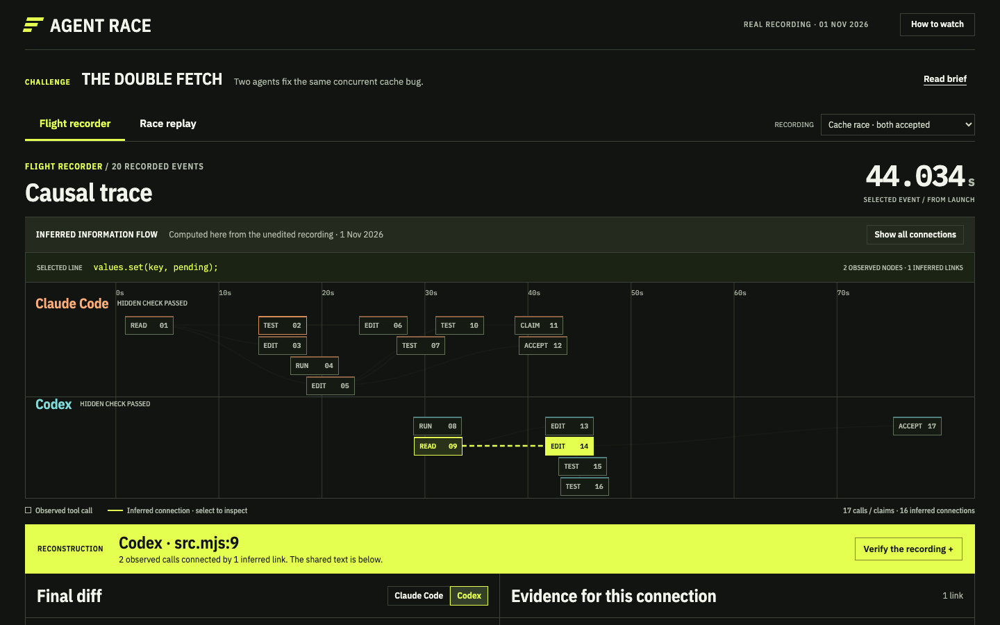

# Agent Race
[](https://harryfreeman.dev)

Two coding agents tackle the same bug in isolated repositories, on one clock. Agent Race turns their recorded commands, edits and test results into a motorsport replay and an evidence flight recorder: choose a changed line, follow its inferred sources, then check the signed recording in your browser. It makes the difference between a claim, a passing command and an independently accepted fix visible. The bundled fair race ends with both agents passing all five hidden cases.

## Try it

Use Node **22.12 or later** and npm:

```sh
npm ci --ignore-scripts
npm run build
npm run preview
```

Open **http://127.0.0.1:4317** for the local preview. `npm run dev` serves development on the same loopback address. The port is fixed.

Installation needs the npm registry; the bundled viewer then works without network access beyond its local server. It needs no model, weights, account, API key, receipts checkout or backend. Fonts, recordings and public signatures are included. It makes no external requests. If WebCrypto/Ed25519 is unavailable, the trace remains usable and signature verification explicitly says unavailable. Missing or invalid recordings show an error and retry, never simulated activity.

Start with a changed line in **Flight recorder**, select a graph edge to inspect its evidence, then open **Verify the recording** and **Change one byte**. **Restore original** verifies again. **Race replay** opens the timing tower; it starts at 8×, or paused with reduced motion. Space plays/pauses outside controls, arrow keys move five seconds, and Escape closes evidence. Earlier failed attempts remain selectable.

Recording a new race is separate and uses networked, authenticated provider CLIs rather than a local model. It requires macOS Seatbelt, Git and an explicitly configured, built [receipts](https://github.com/Hfreeman2025/receipts) checkout. These commands can incur provider usage:

```sh
export RECEIPTS_ROOT=/absolute/path/to/receipts
./bin/agent-race list
./bin/agent-race smoke
./bin/agent-race run single-flight
```

Both CLIs must already be authenticated. The harness does not log in or change global settings. The smoke checks each agent's file read, command execution and receipt before allowing a race. There is a persisted four-attempt cap, no automatic retries, and a privacy check before saving. For replay-only use, none of these steps is needed. See [recording and checks](docs/development.md) for sandbox boundaries and configuration.

## How it works

The harness copies an authored challenge into two temporary repositories, gives Claude Code and Codex the same prompt, and timestamps their structured streams with one monotonic clock. It captures patches and command output, checks recognised verification claims through receipts, and runs independent hidden acceptance after each agent exits. Commentary and sector splits come from deterministic rules over that evidence.

The flight recorder builds an **evidence-labelled lexical provenance DAG**. From a selected changed line, it walks backwards through earlier captured outputs sharing code identifiers or complete lines. It borrows the criterion-driven traversal of [Mark Weiser's *Program Slicing* (1981)](https://doi.org/10.5555/800078.802557); it is a lexical heuristic, not semantic program slicing or access to private reasoning. Each edge exposes its matching text and rule. Edges cannot cross agents or point into the future; unmatched lines stay unlinked. Patches are applied to the original challenge baseline and fail closed on a mismatch.

Two retrospective signed imports use [in-toto Statement v1](https://github.com/in-toto/attestation/blob/main/spec/v1/statement.md), [DSSE](https://github.com/secure-systems-lab/dsse/blob/master/protocol.md) and Ed25519. WebCrypto verifies the original payload bytes against a separately pinned public key before parsing the statement, then checks recording/import-file digests and event association. The one-byte demo changes a recorded exit code in memory and retains the old signature, which fails verification. The UI says **“signed at import from the recorded ledger”**; missing execution facts remain nine explicit nulls. [Method and trust boundaries](docs/method.md) explains what each check establishes.



## What it measures / proves

The default is **The double fetch**, recorded on **1 November 2026 at 12:50:14.922 UTC**, using Claude Code **2.1.286** and Codex CLI **0.160.1**.

| Observation | Claude Code | Codex |
| --- | ---: | ---: |
| Process exit | 0 | 0 |
| Agent regression tests | 5/5 | 4/4 |
| Independent hidden acceptance | 5/5 | 5/5 |
| Launch to independent acceptance | 41.466 s | 77.793 s |

The **36.327 s** gap includes startup, provider latency, agent work, shutdown and local checks. It is not a pure inference-time measurement. These figures come from the [immutable fair recording](public/recordings/demo.json); tests recompute the finish and splits from it.

The trace links **51 of 124 changed lines (41.1%)** to earlier lexical evidence: **17 observed nodes, 16 inferred edges**, with an explicit 16/16 overlap/routing audit in [tests/trace-audit.test.ts](tests/trace-audit.test.ts). The remaining 73 lines stay unlinked. This measures coverage of the heuristic; **causal accuracy is unknown**. The recording has 20 normalised events, five edit events, 36 known path references redacted and zero remaining scrub findings.

[Check results and measurement methods](docs/checks.md) cover serial Chromium, WebKit and Firefox checks at 1440×900 and 390×844, meaningful-paint proxies, font layout stability and the tamper demo. Measurements are from local browser engines and viewport sizes, not physical phones or a general performance benchmark.

## Limits

- One fair recorded task is not a model leaderboard. Three earlier attempts failed or were incomplete; two original replays and the scrub-rejected attempt's [failure report](public/rejected-attempts.txt) remain disclosed. No events were rewritten to manufacture a fair result.
- Lexical overlap may be coincidental. File-to-test edges and the historical claim-to-command association are labelled inferred; a missing match does not establish invention.
- Receipts recognises a bounded claim grammar. Codex's final “Verification passed” remains an unannotated message. A command exit or receipt does not prove test quality or completeness; hidden acceptance is separate.
- Signing was retrospective. Original argv, absolute working directory, shell mode, execution start/end and separate output hashes/counts were not saved. Signatures do not recover those facts or prove execution-time signing, causality or independent identity. A compromised host could replace both viewer and trust anchor.
- Recording uses a macOS-specific sandbox and a deliberately narrow shell recogniser. Provider CLIs need authenticated network access; this is not a network-isolated execution system. Shell heredoc failures and recovery remain visible in the default race.

## How it was built

Designed, specified and reviewed by Harry Freeman; built with AI coding agents.

- **BRIEF:** Harry specified a clean-room experiment with real CLI evidence, independent acceptance, honest failure disclosure and a useful local replay.
- **V2:** He asked for a stronger identity and a signature interaction: motorsport timing, sector splits, photo finish and evidence-linked race control.
- **V3:** He directed the move to a flight recorder: inspect a changed line's inferred sources, verify signed bytes in-browser, and show uncertainty and missing evidence explicitly.
- **Review decisions:** Impact was replaced with an OFL display face, then the work was unified in self-hosted IBM Plex. Verification checks were changed to work in a fresh checkout without a sibling repository; real receipts integration remains an explicit opt-in check.

## Licence

[MIT](LICENSE), **Copyright (c) 2026 Harry Freeman**. IBM Plex fonts retain their **SIL OFL-1.1** notices. See [DEPENDENCIES.md](DEPENDENCIES.md) for pinned font sources and hashes, and the [generated dependency inventory](docs/dependency-licenses.md) for code licences. The [HF badge](docs/brand/LICENSE.md) identifies Harry’s work and is excluded from the code licence. Recordings and public attestations are part of this project; no private signing keys are distributed.
